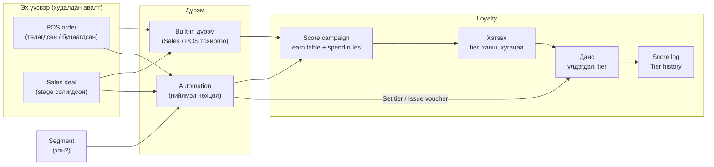

# erxes Loyalty — Product & Support гарын авлага

> **Хэнд зориулсан бэ:** Product manager, support manager, implementation хийдэг хүмүүс.
> **Юу хэлэх вэ:** Loyalty гэж юу вэ, ямар хэсгүүдээс бүрддэг, хоорондоо яаж уялддаг, касс болон борлуулалт дээр яаж харагддаг, асуудал гарахад хаанаас юуг шалгах вэ.
> **Юу хэлэхгүй вэ:** Кодын дэлгэрэнгүй, хуучин хувилбартай харьцуулалт.

Зураг, бичлэгүүд `media/` хавтсанд байна. Юуг яаж авсан нь [CAPTURES.md](CAPTURES.md)-д бичигдсэн.

---

## Агуулга

1. [Loyalty гэж юу вэ](#1-loyalty-гэж-юу-вэ)
2. [Үндсэн ойлголтууд](#2-үндсэн-ойлголтууд)
3. [Бүх зүйл хэрхэн уялддаг](#3-бүх-зүйл-хэрхэн-уялддаг)
4. [Хэтэвч (Wallet)](#4-хэтэвч-wallet)
5. [Данс (Account)](#5-данс-account)
6. [Оноо олгох](#6-оноо-олгох)
7. [Оноо зарцуулах ба буцаах](#7-оноо-зарцуулах-ба-буцаах)
8. [Tier (зэрэглэл)](#8-tier-зэрэглэл)
9. [Хугацаа: pending, expiry, reset](#9-хугацаа-pending-expiry-reset)
10. [Voucher, coupon болон бусад хэрэгсэл](#10-voucher-coupon-болон-бусад-хэрэгсэл)
11. [Касс (POS) дээр](#11-касс-pos-дээр)
12. [Борлуулалт (Sales pipeline) дээр](#12-борлуулалт-sales-pipeline-дээр)
13. [Хаанаас юуг харах вэ](#13-хаанаас-юуг-харах-вэ)
14. [Түгээмэл хэрэглээ (жор)](#14-түгээмэл-хэрэглээ-жор)
15. [Support: асуудал оношлох](#15-support-асуудал-оношлох)
16. [Одоогоор байхгүй зүйлс](#16-одоогоор-байхгүй-зүйлс)
17. [Нэр томьёоны толь](#17-нэр-томьёоны-толь)

---

## 1. Loyalty гэж юу вэ

Loyalty бол **үйлчлүүлэгчийг буцаж ирүүлэх** хэрэгсэл юм. Худалдан авалт бүрт оноо өгч, тэр оноогоор дараагийн худалдан авалтаа төлүүлэх, их худалдан авдаг хүнд өндөр зэрэглэл (tier) олгож илүү урамшуулал өгөх, төрсөн өдөр, анхны худалдан авалт гэх мэт үйл явдалд voucher бэлэглэх зэргийг нэг дор зохицуулна.

Хамгийн амархан ойлгох арга бол **банк** гэж төсөөлөх:

| Банкинд | Loyalty-д | Тайлбар |
| --- | --- | --- |
| Дансны төрөл (хадгаламж, цалингийн) | **Хэтэвч (Wallet)** | Ямар үлдэгдэл хөтлөх, ямар дүрэмтэй байх тохиргоо. Жишээ: "Оноо", "Жилийн худалдан авалт" |
| Харилцагчийн данс | **Данс (Account)** | Нэг хүн (эсвэл байгууллага, ажилтан) бүрт нэг данс. Хэтэвч бүрийн үлдэгдэл, tier энд хадгалагдана |
| Гүйлгээ | **Score log** | Оноо нэмэгдсэн, хасагдсан, буцаагдсан бүх хөдөлгөөн. Үлдэгдэл бол эдгээрийн нийлбэр |
| Хүүгийн нөхцөл | **Score campaign** | "Ямар худалдан авалтад хэдэн оноо өгөх, хэрхэн зарцуулах" дүрэм |
| Картын зэрэглэл (Gold, Platinum) | **Tier** | Хэтэвч доторх зэрэглэл, жишээ нь Silver → Gold → Platinum |

**Гол зарчим:** Loyalty өөрөө "хэн юу худалдаж авсныг" мэддэггүй. Худалдан авалт **эх үүсвэрээс** (POS, Sales deal) ирдэг. Loyalty зөвхөн "энэ хүн ийм дүнгээр худалдан авалт хийлээ, дүрмийн дагуу оноо өг" гэсэн хүсэлтийг хүлээж авч, данс хөтөлнө. Энэ нь шинэ эх үүсвэр нэмэхэд loyalty-г өөрчлөх шаардлагагүй болгодог.

---

## 2. Үндсэн ойлголтууд

| Ойлголт | Нэг өгүүлбэрээр | Хаана тохируулдаг |
| --- | --- | --- |
| **Хэтэвч (Wallet)** | Үлдэгдлийн төрөл ба түүний дүрэм: tier-ийн жагсаалт, ханш, хугацаа, reset | Settings → Loyalty → Wallets |
| **Данс (Account)** | Эзэмшигч бүрийн нэг данс: дугаар, төлөв, хэтэвч бүрийн үлдэгдэл ба tier | Loyalty → Дансууд |
| **Score campaign** | Нэг хэтэвчид оноо **хэрхэн өгөх** (earn table), **хэрхэн зарцуулах** (spend rules) дүрэм | Settings → Loyalty → Score |
| **Built-in дүрэм** | Sales болон POS-ийн өөрийн тохиргоо: "энэ stage / энэ касс дээр тэр campaign-аар оноо өг" | Sales → Boards & Pipelines, POS → Payment |
| **Automation** | Нийлмэл дүрэм: "хэрэв … бол оноо өг / tier тогтоо / voucher олго" | Automations |
| **Segment** | "Хэн" гэдгийг тодорхойлох бүлэг (жишээ нь өнөөдөр төрсөн өдөртэй хүмүүс). Оноо, tier олгодоггүй, зөвхөн шүүнэ | Segments |
| **Score log** | Онооны хөдөлгөөн бүр, яагаад, хэдэн оноо гэдгийн задаргаатай | Loyalty → Оноонууд |
| **Tier history** | Tier өөрчлөгдсөн бүх түүх: хэзээ, юунаас, хэн | Дансны мөр → Tier history |
| **Voucher** | Тодорхой хүнд олгосон хөнгөлөлт, бэлэг | Loyalty → Ваучерууд |
| **Coupon** | Хэн ч хэрэглэж болох код | Loyalty → Купонууд |

---

## 3. Бүх зүйл хэрхэн уялддаг

Энгийн үгээр:

1. **Худалдан авалт** POS эсвэл deal дээр болно.
2. **Дүрэм** (built-in эсвэл automation) "энэ худалдан авалт аль campaign-аар оноо авах вэ" гэдгийг шийднэ.
3. **Campaign** earn table-аараа хэдэн оноо болохыг тооцно.
4. Оноо тухайн campaign-ий **хэтэвч** рүү, эзэмшигчийн **данс** дээр бичигдэнэ.
5. Бүх хөдөлгөөн **score log**-д үлдэнэ. Tier солигдвол **tier history**-д үлдэнэ.

---

## 4. Хэтэвч (Wallet)

Хэтэвч бол loyalty-ийн суурь. Бусад бүх зүйл (campaign, tier, данс) хэтэвч дээр тулгуурлана.

**Хэтэвч дээр тохируулдаг зүйлс:**

| Хэсэг | Тохиргоо | Тайлбар |
| --- | --- | --- |
| Ерөнхий | Нэр | Жишээ: "Оноо", "Жилийн худалдан авалт" |
| | Эзэмшигчийн төрөл | Customer, company эсвэл team member. **Үүсгэсний дараа өөрчлөх боломжгүй** |
| | Хэн оноо авах эрхтэй | Бүгд / зөвхөн client portal-ийн гишүүд / тодорхой segment-ийн гишүүд |
| Оноо | Ханш: 1 оноо = N₮ | Оноо тооцохдоо дүнг N-д хуваана. Жишээ: 1000₮ тутамд 1 оноо бол N = 1000 |
| | Онооны үнэ: 1 оноо = N₮ төлнө | Зарцуулахад нэг оноо хэдэн төгрөгтэй тэнцэх. Хоёр тоог харьцуулж "cashback %" харуулна |
| | Tier-ийн жагсаалт | Доороос дээш эрэмбэтэй: Silver → Gold → Platinum |
| Хугацаа ба reset | Pending хоног | Олгосон оноо N хоногийн дараа л зарцуулах боломжтой болно (default: шууд) |
| | Хугацаа дуусах | Хэзээ ч / reset бүрт / олгосноос N сарын дараа |
| | Reset үе | Хэзээ ч / сар бүр / жил бүр |
| | Reset-ийн үед tier | Хэвээр / tier-гүй болно / хамгийн доод tier |
| | Хөлдөөх үед | Зөвхөн зарцуулахыг хориглох эсвэл бүгдийг хориглох |

Form-ын доод талд **урьдчилсан харагдац** байна: өнөөдөр олгосон оноо хэзээ зарцуулах боломжтой болох, хэзээ дуусах, дараагийн reset хэзээ болох, тэр үед tier юу болохыг харуулна. Тохиргоог хадгалахаасаа өмнө шалгахад хэрэгтэй.

**Support-д хэрэгтэй:** нэг байгууллагад хэд хэдэн хэтэвч байж болно. Жишээ нь "Оноо" (зарцуулдаг) болон "Жилийн худалдан авалт" (зөвхөн tier тогтооход). Хэтэвч архивлавал үлдэгдлүүд хадгалагдана, гэхдээ цаашид шинэ оноо бичигдэхгүй.

---

## 5. Данс (Account)

Данс нь **анхны оноо олгогдох үед автоматаар нээгдэнэ**. Гараар нээх шаардлагагүй. Данс бүр санамсаргүй 10 оронтой дугаартай.

**Loyalty → Дансууд** хуудсанд:

- Эзэмшигч, төрөл, дансны дугаар, төлөв, нэгдсэн огноо.
- Хэтэвч бүр тусдаа баганатай: үлдэгдэл ба tier. Эрхтэй хэрэглэгч tier-ийг шууд тэндээс сольж болно.
- Хайлт: дансны дугаар эсвэл эзэмшигчийн нэрээр. Шүүлтүүр: төлөв, эзэмшигчийн төрөл, хэтэвч, tier.
- Мөрийн цэс: **хөлдөөх** (шалтгаан заавал бичнэ) / **гэсгээх**, **tier history**, **онооны түүх**, **эзэмшигчийн profile**.

Customer, company, team member-ийн profile дээр ч **дансны карт** харагдана: дугаар, төлөв, хэтэвч бүрийн үлдэгдэл, хүлээгдэж буй ба удахгүй дуусах оноо, tier.

**Хөлдөөх (freeze):** сэжигтэй үйлдэл, маргаан гэх мэт тохиолдолд. Хэтэвчийн тохиргооноос хамаараад зөвхөн зарцуулалт эсвэл бүх хөдөлгөөн хориглогдоно. Шалтгаан нь түүхэнд үлдэнэ.

**Эрх:** хөлдөөх/гэсгээх нь `loyaltyAccountFreeze`, tier гараар солих нь `loyaltyAccountSetTier` эрх шаардана. Эрхгүй хэрэглэгч tier-ийг зөвхөн badge хэлбэрээр харна.

---

## 6. Оноо олгох

Оноо олгох **хоёр зам** бий. Энэ хэсэг support-д хамгийн их асуулт гаргадаг тул анхааралтай уншаарай.

### 6.1. Score campaign ба earn table

Campaign бол "хэдэн оноо өгөх вэ" гэдэг тооцоолуур. Нэг campaign нэг хэтэвчид харьяалагдана.

**Earn table** нь мөрүүдээс бүрдэнэ:

- **Үндсэн мөр (base):** таарсан **эхний** үндсэн мөр л оноо өгнө. Жишээ: "дүнгийн 1%", эсвэл "ханшаар ×1".
- **Нэмэлт мөр (bonus):** таарсан **бүх** bonus мөр нэмэгдэнэ. Жишээ: "анхны худалдан авалтад +50 оноо", "Gold tier-т ×2".
- **Нөхцөл:** дүнгийн хязгаар, тодорхой бараа/ангилал, анхны худалдан авалт, эх үүсвэр.
- **Tier-ийн багана:** мөр бүрт "бүгдэд ижил" эсвэл tier тус бүрт өөр утга өгч болно. Хоосон нүд = оноо өгөхгүй.
- **Дээд хязгаар (cap):** нэг мөрөөс хамгийн ихдээ хэдэн оноо.

Form дээр **жишээ тооцоо** харагдана: дурын дүн оруулахад tier бүр хэдэн оноо авахыг сервер тооцож үзүүлнэ. Оноо дээр дарвал тооцооны алхам (дүн × % ÷ ханш, бөөрөнхийлөлт) гарч ирнэ.

> **Хамгийн түгээмэл тохиргоо:** нэг үндсэн мөр, "[1000]₮ тутамд [1] оноо", tier-ээр ялгах бол Gold, Platinum баганад ×2, ×3. Ихэнх бизнест үүнээс илүү хэрэггүй.

### 6.2. Зам 1: Built-in дүрэм (энгийн тохиолдол)

"Энэ касс дээр төлөгдсөн бүх захиалга оноо авна", "энэ pipeline-ий Won stage-д орсон deal оноо авна" гэх мэт энгийн тохиолдлуудад зориулсан. Тохиргоо нь **эх үүсвэр дээрээ** байна:

- **POS:** POS тохиргоо → Payment tab → **"Оноо өгөх campaign"**. Төлөгдсөн захиалга оноо авна, буцаагдсан захиалга бүх оноогоо буцаана.
- **Sales:** Boards & Pipelines → **"Оноо олгох тохиргоо"** dialog → **Оноо** tab. Гурван түвшин: бүх board, тодорхой board-ийн бүх pipeline, тодорхой stage-үүд. Нарийн дүрэм нь өргөн дүрмийг дарна (override).

**Давуу тал:** deal засагдах, Lost болоод буцаад Won болох, customer солигдох зэрэгт оноо **өөрөө зөв болж** тохирно. Учир нь built-in нь "энэ deal-ийн одоогийн төлөвт ямар оноо байх ёстой" гэж бодож тааруулдаг.

### 6.3. Зам 2: Automation (нийлмэл тохиолдол)

"Хэрэв … бол" хэлбэрийн нөхцөл хэрэгтэй үед: тодорхой хугацаанд л идэвхтэй урамшуулал, хэд хэдэн алхамтай дүрэм, earn table-ийн зарим мөрийг л асаах гэх мэт.

- Trigger: POS order, deal stage, customer, segment-д орох/гарах, tier солигдох г.м.
- Action: **Adjust score** (аль campaign, аль мөрүүд), **Set tier**, **Issue voucher**.

Automation-ий түүхэнд action бүрийн үр дүн **хүний хэлээр** харагдана: хэдэн оноо өгсөн, эсвэл яагаад алгассан (жишээ: "энэ tier-т утга тохируулаагүй").

### 6.4. ⚠️ Хоёуланг нь нэг campaign-д бүү ашигла

Нэг campaign-ийг built-in болон automation **хоёулаа** оноо өгөхөөр тохируулбал нэг худалдан авалт **хоёр удаа** оноо авах эрсдэлтэй. Систем үүнийг хэд хэдэн газар анхааруулдаг:

- POS Payment tab: *"Automation мөн энд оноо өгдөг: … Нэгийг нь үлдээгээрэй."*
- Pipeline-ий Loyalty tab: built-in мөр дээр "Also built in" тэмдэг.

**Дүрэм:** энгийн бол built-in, нийлмэл бол automation. Аль нэгийг нь сонго.

---

## 7. Оноо зарцуулах ба буцаах

**Зарцуулах:** POS дээр онооноос төлөх нь **төлбөрийн төрөл** хэлбэрээр ажиллана. POS → Payment → "Other payments" дээр score campaign-тай холбосон төлбөрийн төрөл нэмнэ. Кассчин түүгээр төлбөр авахад оноо хасагдана.

Campaign-ий **Subtract** tab дээрх зарцуулах дүрэм:

| Дүрэм | Жишээ |
| --- | --- |
| Хамгийн бага үлдэгдэл | 500-аас доош оноотой бол зарцуулж болохгүй |
| Төлбөрийн дээд хувь | Захиалгын 30%-иас илүүг оноогоор төлж болохгүй |
| Алхам | 100 оноогоор л зарцуулна (100, 200, 300 …) |

**Буцаах (refund):**

- **POS:** захиалга буцаагдвал (return) тэр захиалгаар олгосон ба зарцуулсан бүх оноо буцна.
- **Deal:** "Оноо олгох тохиргоо" дээр заасан буцаах stage (ихэвчлэн Lost) руу орвол буцна.
- **Tier буцахгүй:** буцаалт tier-т нөлөөлөхгүй.
- **Өр:** буцаах үед үлдэгдэл хүрэлцэхгүй бол данс **сөрөг** болж болно. Дараагийн олголт эхлээд өрийг хаана.

---

## 8. Tier (зэрэглэл)

Tier бол хэтэвч доторх зэрэглэл. Earn table-д tier бүрт өөр утга өгснөөр Gold хүн илүү оноо авна. Мөн automation-д "Gold бол үнэгүй хүргэлт" гэх мэт нөхцөл болгоно.

**Tier-ийг юу ч тогтоож болно.** Loyalty tier хэрхэн шийдэгдэхийг мэдэх шаардлагагүй, зөвхөн хадгалж, харуулна:

| Арга | Хэзээ | Хаана |
| --- | --- | --- |
| **Худалдан авалтын дүнгээр (built-in)** | "Нэг удаад 1 сая₮-өөс дээш авбал Gold" | Sales: "Оноо олгох тохиргоо" → **Tier** tab. POS: Payment → **"Tier тогтоох"** |
| **Automation: Set tier** | Нийлмэл нөхцөл: segment, хугацааны нийт дүн, гадны систем | Automation builder |
| **Гараар** | Онцгой тохиолдол, гомдол шийдвэрлэх | Дансууд хуудас, дансны карт |
| **Reset** | Жил/сар эхлэхэд | Хэтэвчийн reset тохиргоо |

**Дүнгийн муж (bands):** tier бүрт "Хэдээс – хэд хүртэл" гэж өгнө. Хоёр муж нийлсэн цэг дээр **өндөр tier** ялна. Жишээ: Silver 0–1,000,000, Gold 1,000,000-аас дээш бол яг 1,000,000₮ = Gold.

**"Зөвхөн ахиулах" (only upgrade):** чагтлавал бага дүнтэй худалдан авалт tier-ийг **бууруулахгүй**. Ихэнх тохиолдолд асаалттай байлгах нь зөв.

**Tier солигдсон үед юу болох вэ:**

- **Tier history**-д мөр бичигдэнэ: хуучин → шинэ, хэзээ, **юунаас** (худалдан авалт "POS #123" / deal нэр, automation-ий нэр, reset, гараар), **хэн**.
- **"Tier changed" trigger** ажиллана, жишээ нь "Gold болоход +100 оноо бэлэглэх" automation.

---

## 9. Хугацаа: pending, expiry, reset

Бүх хугацааны ажил **байгууллага бүрт өдөрт нэг удаа, шөнийн 00:05-д** ажиллана.

| Ойлголт | Утга | Жишээ |
| --- | --- | --- |
| **Pending (хүлээгдэж буй)** | Олгосон оноо N хоногийн дараа л зарцуулах боломжтой | Буцаалтын хугацаа 14 хоног бол pending 14 хоног. Энэ хугацаанд буцаавал pending оноо л буцна |
| **Expiry (хугацаа дуусах)** | Оноо мөнхийн биш | "Олгосноос 12 сарын дараа" бол хуучин оноо эхэлж зарцуулагдана (FIFO) |
| **Reset** | Календарийн үе дуусахад эхнээс нь | Жил бүр 1-р сарын 1-нд үлдэгдэл 0, tier хамгийн доод руу |

**Анхаарах:** reset-ээс хойш pending-ээс гарах оноо өгөгдөхгүй. Жилийн reset-тэй хэтэвчид 12-р сарын сүүлээр олгосон pending оноо шинэ жилд шилжихгүй.

Дансны карт дээр **хүлээгдэж буй** ба **удахгүй дуусах** оноо тусдаа харагдана.

---

## 10. Voucher, coupon болон бусад хэрэгсэл

| Хэрэгсэл | Юу вэ | Түгээмэл хэрэглээ |
| --- | --- | --- |
| **Voucher** | Тодорхой эзэмшигчид олгосон хөнгөлөлт, бэлэг бараа. Customer сонгоход касс дээр харагдана | Төрсөн өдөр, анхны худалдан авалт, tier ахисны бэлэг |
| **Coupon** | Эзэмшигчгүй код, хэн ч оруулж болно | Сурталчилгааны код, нөлөөлөгчийн код |
| **Spin** | Азын хүрд | Event, урамшууллын тоглоом |
| **Lottery** | Сугалаа | Тодорхой хугацааны сугалаа |
| **Donate** | Оноогоо хандивлаж, хандивын хэмжээгээр шагнал (voucher) авах | Оноо зарцуулах сонирхолтой арга, CSR |
| **Assignment** | Segment-ийн гишүүдэд voucher campaign-аас voucher оноох | Бүлэг хүмүүст нэг дор олгох |
| **Agents** | Агент (customer эсвэл company) бүрт хугацаа ба барааны дүрэмтэй урамшуулал, мөнгө буцаалт | Борлуулалтын агент, түнш |

**Voucher-ийн хязгаар:** voucher campaign дээр "**Нэг customer-т**" хязгаар бий: хэдэн удаа, ямар хугацаанд (жил / сар / бүх campaign). Энэ нь төрсөн өдрөө өөрчлөөд хоёр дахь бэлэг авахаас хамгаална.

**Төрсөн өдрийн voucher:** voucher campaign-ийн засах цонхонд **"Төрсөн өдөр"** tab бий. "Төрсөн өдрөөр олгох" дарахад систем шаардлагатай segment, шөнийн broadcast болон automation-ийг өөрөө үүсгэнэ.

---

## 11. Касс (POS) дээр

Кассчин loyalty-г **customer сонгосон үед** л харна. Зөвхөн тухайн захиалгын customer-ийнх, түүхгүй.

**Кассчин юу харах вэ:**

- Хэтэвч бүрийн **үлдэгдэл**, **tier**, хүлээгдэж буй ба удахгүй дуусах оноо.
- **"Энэ худалдан авалтаар +N оноо"**: төлөхөөс өмнөх урьдчилсан тооцоо. 0 бол шалтгаан нь бичигдэнэ (жишээ: "нөхцөл хангагдаагүй").
- **Voucher-ууд:** хэрэглэх товчтой. Нэг захиалгад нэг voucher. Тохирохгүй бол шалтгаан нь харагдана.
- **Coupon код** оруулах талбар, зөвхөн тухайн POS дээр **"Coupon хүлээн авах"** асаалттай үед.
- Pricing болон loyalty-ийн хөнгөлөлтөөр **шинэчлэгдсэн үнэ** мөр бүр дээр харагдана. Энэ нь зөвхөн дэлгэцийн урьдчилсан харагдац, төлбөр хадгалагдсан захиалгын дүнгээр явна.

**Loyalty тохируулаагүй байгууллагад** customer сонгоход доор нь юу ч гарахгүй. Энэ нь санаатай.

**Шинэ customer бүртгэх:** POS тохиргоо → "Customer registration" асаалттай бол кассчин хайлтын цонхноос **"Хэрэглэгч нэмэх"**-ээр шууд бүртгэнэ. Form-ын талбаруудыг admin layout editor-оор тохируулна. Ижил утас, имэйлтэй customer байвал "энэ хүнийг сонгох уу?" гэж асууна.

**POS тохиргоонд loyalty-тэй холбоотой хэсгүүд (Payment tab):**

| Тохиргоо | Утга |
| --- | --- |
| Оноо өгөх campaign | Төлөгдсөн захиалга энэ campaign-аар оноо авна |
| Tier тогтоох | Төлөгдсөн захиалгын дүнгээр tier тогтооно |
| Coupon хүлээн авах | Касс дээр coupon код оруулах талбар харагдана (default: унтраалттай) |
| Other payments → онооны төлбөр | Онооноос төлөх |

> POS тохиргоог өөрчилсний дараа касс дээр **config sync** хийж байж шинэчлэгдэнэ.

---

## 12. Борлуулалт (Sales pipeline) дээр

- **Оноо олгох тохиргоо** (Boards & Pipelines): Оноо ба Tier tab. Аль stage-д оноо/tier олгох, аль stage-д буцаахыг тохируулна.
- **Stage badge:** pipeline засах цонхонд stage бүр дээр ямар оноо, tier олгогдохыг тэмдгээр харуулна.
- **Deal list:** "Loyalty points" багана. **Board card:** картын доод хэсэгт онооны badge.
- **Deal-ийн дэлгэрэнгүй:** Loyalty widget тухайн deal-ээр хөдөлсөн оноо (олгосон / зарцуулсан / буцаасан) болон tier өөрчлөлтийг харуулна.
- **Pipeline-ий Loyalty tab:** энэ pipeline-тэй холбоотой бүх loyalty холболт (built-in ба automation), анхааруулгатай.

---

## 13. Хаанаас юуг харах вэ

| Асуулт | Хаана |
| --- | --- |
| Энэ хүн хэдэн оноотой, ямар tier-тэй вэ? | Customer profile → дансны карт, эсвэл Loyalty → Дансууд |
| Яагаад ийм оноо авсан бэ? | Loyalty → Оноонууд, owner-оор шүүнэ. **Breakdown** нүдэн дээр дарвал тооцооны алхам |
| Энэ захиалга / deal ямар оноо хөдөлгөсөн бэ? | Order эсвэл deal-ийн loyalty widget |
| Tier хэзээ, юунаас солигдсон бэ? | Дансны мөрийн цэс → Tier history |
| Automation яагаад оноо өгөөгүй вэ? | Automation → History → action-ий үр дүн (алгассан шалтгаан) |
| Энэ campaign-д юу оноо өгдөг вэ? | Score campaign → **Automations** tab |
| Энэ касс / pipeline-д ямар loyalty холбогдсон бэ? | POS эсвэл pipeline тохиргооны **Loyalty** tab |

---

## 14. Түгээмэл хэрэглээ (жор)

### "1000₮ тутамд 1 оноо, 1 оноо = 1₮"

1. Хэтэвч үүсгэх: "Оноо", customer, ханш 1000, онооны үнэ 1.
2. Score campaign: энэ хэтэвч, earn table-д нэг үндсэн мөр.
3. POS → Payment → "Оноо өгөх campaign" = энэ campaign.
4. POS → Payment → Other payments: энэ campaign-тай онооны төлбөр.

### "Жилийн худалдан авалтаар Silver / Gold / Platinum"

1. Хэтэвч: tier-ийн жагсаалт Silver, Gold, Platinum; reset жил бүр; tier → хамгийн доод.
2. Нэг удаагийн дүнгээр бол: POS → "Tier тогтоох" эсвэл Sales → Tier tab, мужуудыг оруулна, "зөвхөн ахиулах" асаана.
3. Жилийн **нийт** дүнгээр бол: segment (жилийн худалдан авалт ≥ X) + automation **Set tier**.

### "Tier ахихад +100 оноо"

Automation: trigger **Tier changed** (хэтэвч, чиглэл: дээш, tier: Gold) → action **Adjust score** (+100).

### "Анхны худалдан авалтад welcome voucher"

Segment (худалдан авалт ≥ 1) → membership trigger "Joined", нэг удаа → **Issue voucher**.

### "Төрсөн өдрийн coupon"

Voucher campaign → **Төрсөн өдөр** tab → "Төрсөн өдрөөр олгох". "Нэг customer-т" хязгаарыг жилд 1 болгоно.

---

## 15. Support: асуудал оношлох

### "Оноо ороогүй"

Дарааллаар нь шалгана:

1. **Customer сонгосон уу?** Оноо захиалгын customer-т л ордог. Customer-гүй захиалга оноо авахгүй.
2. **Захиалга төлөгдсөн үү / deal оноо олгох stage-д орсон уу?**
3. **Дүрэм байна уу?** POS → Payment → "Оноо өгөх campaign", эсвэл pipeline-ий "Оноо олгох тохиргоо", эсвэл идэвхтэй automation.
4. **Campaign идэвхтэй юу?** Идэвхгүй campaign дээр анхааруулга гарна.
5. **Customer эрхтэй юу?** Хэтэвч "зөвхөн segment-ийн гишүүд" бол тэр хүн гишүүн мөн үү.
6. **Данс хөлдсөн үү?**
7. **Pending үү?** Оноо орсон, гэхдээ хүлээгдэж буй. Дансны карт дээр "хүлээгдэж буй" гэж харагдана.
8. **Score log-д 0 оноотой мөр байна уу?** Байвал шалтгаан нь бичигдэнэ:

| Шалтгаан | Утга |
| --- | --- |
| Оноо өгөх мөр тохируулаагүй | Automation earn table-ийн аль ч мөрийг асаагаагүй |
| Энэ зэрэглэлд утга тохируулаагүй | Тухайн tier-ийн баганын нүд хоосон |
| Нөхцөл хангагдаагүй | Дүн, бараа, анхны худалдан авалтын нөхцөл таарсангүй |
| Тооцох дүн алга | Оноогоор бүтэн төлсөн г.м. |
| Дүн бага тул 0 болсон | Бөөрөнхийлөөд 0 гарсан |
| Хүлээгдэх хугацаа reset-ээс хойш дуусна | Pending нь reset-ээс хойш гарах тул өгөгдөөгүй |
| Шаардлага хангаагүй | Хэтэвчийн "хэн оноо авах" нөхцөлд таараагүй |

### "Оноо хоёр дахин орсон"

Нэг campaign-ийг built-in болон automation хоёулаа оноо өгөхөөр тохируулсан байх магадлалтай ([6.4](#64-️-хоёуланг-нь-нэг-campaign-д-бүү-ашигла)). Campaign → Automations tab-аас шалгаад нэгийг нь унтраана.

### "Tier буурсан"

- **Reset** болсон уу? Хэтэвчийн reset тохиргоо.
- Худалдан авалтын дүнгээр tier тогтоох дүрэмд **"зөвхөн ахиулах"** унтраалттай байна уу?
- Tier history → "юунаас" баганаас хариулт шууд харагдана.

### "Касс дээр loyalty харагдахгүй"

- Customer сонгосон уу? (Company эсвэл customer type биш, customer.)
- Customer-т данс, үлдэгдэл, voucher байхгүй, POS дээр оноо өгөх дүрэм ч байхгүй бол panel хоосон байна. Энэ нь зөв.

### "Coupon оруулах талбар алга"

POS → Payment → **"Coupon хүлээн авах"** асаалттай юу? Асаасны дараа касс дээр config sync хийх.

### "Оноогоор төлж чадахгүй байна"

Campaign-ий Subtract дүрэм: хамгийн бага үлдэгдэл, төлбөрийн дээд хувь, алхам. Данс хөлдсөн эсэх. Pending оноо зарцуулагдахгүй.

---

## 16. Одоогоор байхгүй зүйлс

Хэрэглэгч асуувал "төлөвлөгдөөгүй / одоогоор боломжгүй" гэж хариулна:

- **Тамганы карт / Goal** ("10 кофе → 1 үнэгүй"): одоогоор байхгүй.
- **Онооны дэлгүүр (points shop):** loyalty-ийн биш, борлуулдаг модулийн ажил.
- **Баримт дээр оноо хэвлэх:** байхгүй.
- **Score log-ийг deal-ийн board, pipeline-аар шүүх:** байхгүй. Оронд нь deal list дээр "Loyalty points" багана бий.
- **Хуучин онооны талбараас данс руу шилжүүлэх (backfill):** хуучин campaign-уудын онооны талбарыг Settings → Wallets дээрх **"Хэтэвч болгох"** товчоор хэтэвч болгоно. Түүхэн үлдэгдлийг бүрэн нөхөх migration хараахан гараагүй.
- **Хугацааны нийт дүнгээр tier (built-in):** built-in нь зөвхөн **нэг удаагийн** худалдан авалтын дүнг хардаг. Нийт дүнгээр бол segment + automation.

---

## 17. Нэр томьёоны толь

| UI (Монгол) | UI (English) | Тайлбар |
| --- | --- | --- |
| Хэтэвч | Wallet | Үлдэгдлийн төрөл ба дүрэм |
| Данс | Account | Эзэмшигч бүрийн данс |
| Оноонууд | Scores | Онооны хөдөлгөөний жагсаалт |
| Score campaign | Score campaign | Оноо өгөх, зарцуулах дүрэм |
| Оноо олгох тохиргоо | Score earn configuration | Sales-ийн built-in дүрэм |
| Оноо өгөх campaign | Earn points in | POS-ийн built-in оноо |
| Tier тогтоох | Set tier by | POS-ийн built-in tier |
| Coupon хүлээн авах | Accept coupons | POS дээр coupon код авах |
| Хүлээгдэж буй | Pending | Хараахан зарцуулах боломжгүй оноо |
| Хөлдөөх | Freeze | Дансны хөдөлгөөнийг хориглох |
| Ваучерууд | Vouchers | Эзэмшигчид олгосон хөнгөлөлт |
| Купонууд | Coupons | Эзэмшигчгүй код |
